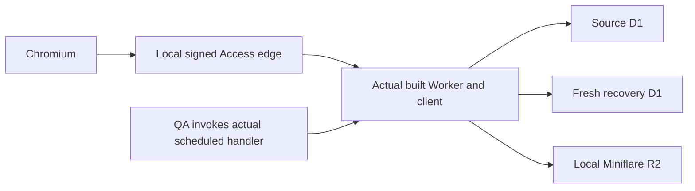

# Genuine local Worker recovery browser qualification

The recovery page's actual current24 Worker path passed two local Chromium
cases on 2026-10-15: **1280/light** and **390/dark**. Each case used its own
Wrangler-migrated source D1, fresh target D1 and Miniflare R2 namespace. The
first tested local build used PR313 candidate `6ca0d8c`; its Worker
entry SHA-256 was `5626ffb3213a79fe4cfa418f0cb61f36812ce6dca6941020705100450bd3c69b`.
The initial QA result changed no product runtime source. The subsequent
responsive control correction below changes recovery-page CSS only.

## Actual path



The owned loopback edge injects a locally signed Access JWT on ordinary requests
and download handoffs, preserving the browser's public URL/Origin. The actual
Worker verifies that JWT against a local JWKS HTTP server. The edge forwards
real responses and does not implement recovery APIs. An ordinary authenticated
account is denied privileged backup access.

Setup creates a Sample, uploads a real PNG and associates it with a history
record through public HTTP routes. Public shadow/profile controls admit the R2
bootstrap destination. No business or authority SQL fixture writes prepare the
source. Independent SQL reads inspect the source and target after recovery.

The browser enables recovery execution, previews/starts a historical backup,
downloads the real ZIP, uploads it, reads its validation preview, supplies the
explicit destination mapping, stages recovery and downloads the verified report.
Each case makes exactly five recovery mutations. Actual scheduled events advance
the durable jobs: backup4, upload1, recovery77. The browser never dispatches work
by reading status or report endpoints.

| Observed per case | Result |
| --- | --- |
| Actual archive | `system-backup/3`,103tables,51original rows,1PNG,68payload bytes |
| Original Sample and history | Observed rowids/cells preserved; source rows unchanged |
| Repaired event File binding | Matches the independently verified restored File and public `file_binding` audit |
| Source and relocated target PNG | Exact bytes and SHA-256 `c2510d21015c1d76d437f7414653615b7f04d90ec357f03aedc8c89dd69bfab3` |
| Target execution | All four authority/shadow/File-job/recovery guards0; native bindings absent; fresh-target claim ready |
| Source authority | Observed post-setup `overlap` mode unchanged; original source still serves reads |
| Foreign keys | Source and target checks clean |
| Crosspage continuity | Storage→Migration→Data→Recovery reopens original verified report;0new mutations |
| Presentation and closure | Exact viewport width, visible restored preview focus; no unexpected console/page/proxy errors; both runtimes and browser closed |

Current24 selects V3 on the ordinary Worker schema. The admitted V5 branch,
Node SPA, remote providers, deployment, physical devices and elapsed scheduler
cadence retain separate scopes. The independent readback covers the selected
Sample/history/File payload; it does not claim whole-catalog typed-cell or
negative-rowid coverage. Earlier native backend qualifications keep their own
original sources and limits. Target readiness never changes a running binding.

## Repeat locally

With the pinned Node version and installed dependencies:

```sh
npm run build
PLAYWRIGHT_MODULE_PATH=/opt/codex/runtimes/cua/lib/node_modules/playwright-core \
CHROMIUM_PATH=/usr/bin/chromium \
node scripts/qa/phase5f/browser-genuine-worker-recovery.mjs \
  --output /tmp/NEW_OUTPUT_DIRECTORY --browser
```

Use an existing Playwright Core/Chromium installation and a new output directory
outside the checkout. The optional `--probe` mode runs the real API cycle without
Chromium. Heavy browser checks remain local/GitHub CI, outside Cloudflare build.

Local original evidence is `/tmp/frontend-genuine-worker-recovery-browser-attempt4/report.json`;
its two case directories contain screenshots, migrations and request observations.
Earlier unsuccessful attempts remain separate: profile-envelope accessor, missing
edge header during download, proxy Origin mismatch and redundant CDP response-body
inspection. These QA fixes preserved actual JWT/Origin checks and product code.
The final74.8s result is a local test duration, not production latency or cadence.

A later `CI=true` reproduction exposed another secondary inspector-body read
failure after the real client had rendered a successful backup preview. The
helper now checks exact browser HTTP statuses, validates each original POST input
and its exact signed request receipt, and checks the real client's job/intent
state. It does not read response bodies again through CDP. Downloaded archive and
report bytes, independent native readback and all five browser mutations retain
their original assertions. The original failed local and hosted runs remain
separate evidence; a local reproduction does not establish the inaccessible
hosted error message.
The corrected helper passed both full `CI=true` local cases in
`/tmp/pr314-cdp-body-fix-ci-true-local-full-attempt1/report.json`; this remains
local evidence, separate from the candidate's hosted workflow results.

The corrected observer then exposed a genuine hosted mobile layout failure:
390px viewport,402px document. Actual styled-DOM diagnosis with DejaVu Sans
reproduced the402px width: the nonwrapping "Release source maintenance window"
button extended to402.17px. Recovery-page buttons now stay within their available
width and wrap their labels. The same diagnosis then measured a390px document;
the mapping tables retain their own horizontal scrolling. This layout diagnosis
does not replace the full genuine-backend browser qualification or its hosted
results. The original hosted failures remain recorded separately.
After rebuilding the scoped CSS change, both complete `CI=true` genuine cases
passed in `/tmp/pr314-recovery-button-wrap-genuine-ci-true-attempt1/report.json`.
Mapping and final-report document widths were exactly1280/390px, with all native
readback, receipt, mutation and closure checks retained. Separately, twelve
rebuilt-CSS layout cases (three fonts, four long labels) passed without injecting
a style fix. Those static cases are layout diagnosis, not twelve backend cases.

## GitHub automation

The dedicated `Genuine Worker recovery browser` workflow builds the checked-out
candidate and runs the same two cases for relevant development/candidate pushes
and pull requests. It uses Node24.19.0, an existing Ubuntu Chrome and pinned
Playwright Core1.57.0 in the runner temporary directory. It changes no repository
package manifest or lockfile and downloads no browser. Its15-minute outer job
allowance retains the helper's three-minute QA job-step deadline and existing
production kernel limits. Reports and screenshots are explicitly listed for
artifact upload; databases, R2 persistence, ZIPs and runtime configuration are
excluded. Hosted results are recorded separately when the successor runs.
On failure, one bounded escaped Actions error annotation preserves the original
exception in the Checks API as well as the report; failure still exits nonzero.
